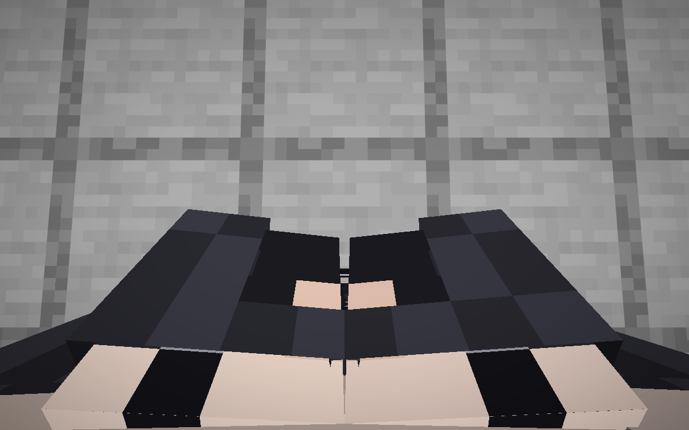
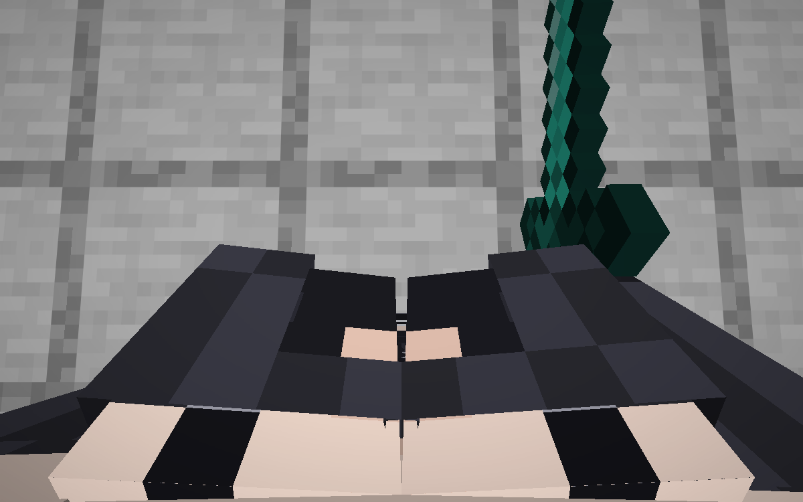

# Kotost First Person

A native mod for [Horizon](https://playhorizon.dev) (Minecraft: Java Edition 26.3 rewritten in Rust).

- **Your own body in first person**: look down and you see your body, legs and both arms in 3D, in your own skin,
  instead of the flat floating hands. The body leans back as you look down, so you never look inside your shoulders.
- **Items in your 3D hands**: the model's right arm holds your item (and the left one the off-hand item).
- **Eating and drinking**: the game's own hands bring the food before your face while you eat (`eat_hand = 1`), or
  the 3D arm does (`eat_hand = 0`).
- **One shadow**: with a shader pack the shadow pass keeps the head where it really is, so your shadow is one body.

Works alone. With [Kotost Bust](https://github.com/Leks2000/kotost-body) your first-person body has the bust and the
hourglass figure too, and with [Kotost Mage](https://github.com/Leks2000/kotost-mage) the dress and the staff:
whatever another mod draws on the player model shows on it, since it is the game's own player model drawn once more.

<table>
  <tr>
    <td width="50%"></td>
    <td width="50%"></td>
  </tr>
</table>

## Install

You need the Horizon launcher from [playhorizon.dev](https://playhorizon.dev) and a Microsoft account that owns
Minecraft: Java Edition.

1. Open the launcher, go to **Mods** and find **Kotost First Person** (once the registry lists it), or press
   **Add from GitHub** and paste `https://github.com/Leks2000/kotost-firstperson`.
2. The launcher warns that a native mod runs with full access to your computer. That is true of every native mod:
   read the source first (a few short `.rs` files).
3. The launcher builds the game with the mod (the first build takes 20-40 minutes, later ones a few), then Play.

Command line, the same thing:

```
horizon-launcher mods add-github https://github.com/Leks2000/kotost-firstperson --trust-native-code
```

Client-side only: servers need nothing.

## Settings: `kotost-firstperson.txt`

The mod writes `config/kotost-firstperson.txt` in your game folder on its first run (the folder with `options.txt`;
on Windows by default `%APPDATA%\horizon\config\`). If you played Kotost Body 0.3, its first-person lines from
`kotost-body.txt` are carried over. The game re-reads the file twice a second: no restart. A line you delete goes
back to its default.

| Key | Default | What it does |
| --- | --- | --- |
| `first_person` | `1` | `0`: the game's usual first person. |
| `left_arm` | `1` | The model's left arm shows. |
| `right_arm` | `1` | The model's right arm and held items in 3D instead of the flat hands (`0`: the game's hands). |
| `back` | `0.0` | How far the body is pushed back (blocks) looking straight ahead. |
| `back_down` | `0.27` | Extra push back looking down. |
| `eat` | `1` | `eat_hand = 0`: the 3D arm brings the item before your face and bobs (`0`: it doesn't). |
| `eat_hand` | `1` | `1`: while eating or drinking, the game's own first-person hands show the food. |
| `eat_up`, `eat_across`, `eat_bob` | `1.35`, `0.6`, `0.16` | The 3D arm while eating: how high, how far across, the bob of each bite. |

`kotost-firstperson.txt` in this repository is the file the mod writes, with every key at its default.

## How it works

In first person the game draws the player model only for the shadow pass. The mod draws it twice: the shadow
copy with only the head at the true position, and a visible copy pushed back by the camera, with the head and hat
hidden and the arms and held items shown. The flat hands are cancelled through the `render_hand` hook.

Hooks (all `HEAD`, see `horizon-mixin.toml`): `player_model_geometry`, `cosmetics_fx_geometry`,
`player_model_shown`, `player_model_visibility`, `cosmetics::covered`, `held_item_geometry`, `head_item_geometry`,
`render_hand`, and `anim::setup` / `anim::bob` for eating. State lives in `runtime.rs` (`horizon_client::kotost_fp`).
It has `priority = 90`, below Kotost Bust's 100, so where both hook one function the bust's hook runs first.

Built for Horizon `fdc87ae` (Nightly 2026-11-08); the launcher pins that commit when it builds the mod.

## License

MIT, see [LICENSE](LICENSE). Not affiliated with Mojang, Microsoft or the Horizon project.
